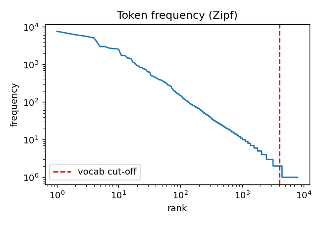
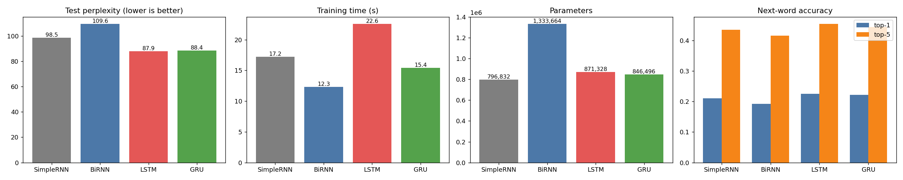
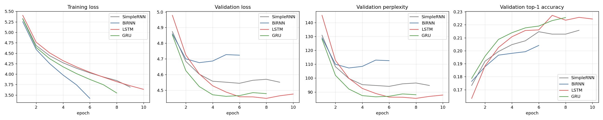
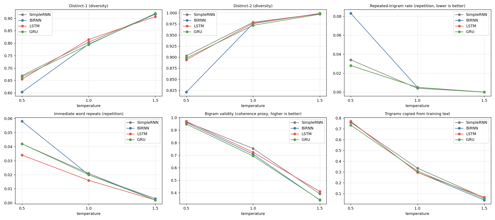

# Sherlock Holmes Autoregressive Text Generation

Foundations of Generative AI (ICT4403), Assignment 2

## Objective

Develop and compare four word-level autoregressive language models (Simple RNN, Bidirectional RNN, LSTM, and GRU) on *The Adventures of Sherlock Holmes*. Each model predicts the next token from the preceding 20 tokens and generates text by repeatedly sampling a prediction and appending it to the context.

The comparison covers prediction quality, training cost, and the coherence, diversity, contextual consistency, and repetition of generated text.

### Results

- [Training configuration, histories, test metrics, and timings](outputs/training_results.json)
- [Quantitative results](outputs/results.csv)
- [Generated text](outputs/generations.md)
- [Per-sample generation metrics](outputs/generation_metrics_all_samples.csv) and [aggregated metrics](outputs/generation_summary.csv)

Results and training times are reported from `outputs/training_results.json` and `outputs/results.csv`. Training times depend on the execution hardware.

## Dataset, preparation, and training

### Dataset description and source

- Title: *The Adventures of Sherlock Holmes*
- Author: Arthur Conan Doyle
- Source: Project Gutenberg, ebook 1661
- Dataset page: https://www.gutenberg.org/ebooks/1661
- Plain-text download: https://www.gutenberg.org/cache/epub/1661/pg1661.txt
- Fallback download: https://www.gutenberg.org/files/1661/1661-0.txt
- Local dataset: [sherlock_holmes.txt](sherlock_holmes.txt)

This English detective-fiction collection contains first-person narration, dialogue, recurring characters, and descriptions of investigations. Its repeated narrative patterns and vocabulary make it suitable for learning next-token probabilities and short stylistic continuations. It is a single-author literary corpus, not a representative sample of general English; historical language and biases may be reproduced by the models.

The following counts describe the text after removing the Gutenberg wrapper, with token statistics measured after preprocessing. Counts are recorded in [dataset_stats.json](outputs/dataset_stats.json) and the [execution log](output.md).

| Characteristic | Observed value |
|---|---:|
| Characters | 562,202 |
| Lines | 11,922 |
| Paragraphs | 2,546 |
| Whitespace-separated words | 104,506 |
| Model tokens, including punctuation and paragraph markers | 129,084 |
| Unique token types before vocabulary truncation | 7,955 |
| Token types appearing once | 3,521 |
| Model vocabulary, including `<unk>` | 4,000 |
| Tokens mapped to `<unk>` across the corpus | 3.4% |

The most frequent tokens include the comma (7,659), full stop (6,208), `the` (5,630), double quote (5,089), and `and` (3,018). Thus, next-token accuracy includes punctuation prediction and is not exclusively accuracy on lexical words. The large number of singleton types motivates limiting vocabulary size.



### Preprocessing used in this experiment

The implementation in [main.py](main.py) performs the following operations:

1. Read the UTF-8 text, allowing an optional byte-order mark, and remove the Project Gutenberg header and footer using their boundary markers.
2. Normalize line endings, curly quotation marks, apostrophes, em dashes, and double hyphens.
3. Convert text to lowercase.
4. Replace blank-line paragraph boundaries with `<p>` and ordinary hard-wrapped line breaks with spaces.
5. Tokenize alphabetic words with internal apostrophes, punctuation `. , ! ? ; : " - ( )`, and `<p>`. Digits and unmatched characters are omitted.
6. Retain the 3,999 most frequent corpus tokens and reserve index 0 for `<unk>`. Map all other tokens to `<unk>` using the same saved vocabulary for every model.
7. Split the token IDs chronologically into training, validation, and test partitions.

The title, author line, and contents remain inside the extracted ebook body. This is visible in the first training example; removing Gutenberg's wrapper does not remove all front matter.

Limitation: vocabulary frequencies are computed from the entire corpus before splitting. Although sequence windows do not cross partition boundaries, vocabulary selection uses held-out information. A strictly leakage-free experiment would fit the vocabulary on training tokens only and retrain all four models.

### Input–target sequences

The split is chronological: the first 90% of tokens are training data, the next 5% validation data, and the remaining 5% test data. Integer truncation produces:

| Partition | Tokens | Input shape | Target shape |
|---|---:|---|---|
| Training | 116,175 | `(116155, 20)` | `(116155,)` |
| Validation | 6,454 | `(6434, 20)` | `(6434,)` |
| Test | 6,455 | `(6435, 20)` | `(6435,)` |

For context length `L = 20` and stride 1:

```text
X[i] = token_ids[i : i + 20]
y[i] = token_ids[i + 20]
```

A partition of `N` tokens supplies `N - 20` examples. Windows are constructed independently within each partition, preventing a training context from containing validation or test tokens. Neighboring windows overlap within a partition, and only training batches are shuffled.

The actual first training pair is:

```text
Input:  the adventures of sherlock holmes <p> by arthur <unk> <unk>
        <p> contents <p> i . a scandal in bohemia ii
Target: .
```

### Model architectures

All models use the same prediction pipeline:

```text
20 token IDs → Embedding(4000, 64) → one recurrent layer
            → final hidden representation → Dropout(0.3)
            → Linear projection to 4000 logits
```

Cross-entropy training operates directly on logits. Softmax is applied during sampling to obtain next-token probabilities.

| Model | Recurrent mechanism and representation | Trainable parameters |
|---|---|---:|
| SimpleRNN | Tanh recurrence; final 128-dimensional hidden state | 796,832 |
| BiRNN | Forward and backward tanh RNNs; concatenate final states into 256 dimensions | 1,333,664 |
| LSTM | Input, forget, and output gates with a separate cell state; final 128-dimensional hidden state | 871,328 |
| GRU | Reset and update gates; final 128-dimensional hidden state | 846,496 |

The BiRNN does not read the target or future generated text: both directions process only the already-known 20-token context. It remains valid for next-token prediction, although it recomputes the complete context window for every generated token.

These experiments hold layer count and hidden width fixed, not parameter count. In particular, BiRNN has approximately 1.67 times the parameters of SimpleRNN. Differences should not be attributed solely to recurrent-cell design under an equal-capacity assumption.

### Comparable training conditions

| Setting | Value for all four models |
|---|---|
| Vocabulary and partitions | Same token IDs and chronological 90/5/5 split |
| Context length / stride | 20 / 1 |
| Embedding / hidden dimensions | 64 / 128 per direction |
| Recurrent layers | 1 |
| Output dropout | 0.3 |
| Batch size | 256 |
| Optimizer | Adam |
| Initial learning rate | 0.002 |
| Learning-rate scheduler | ReduceLROnPlateau on validation loss; factor 0.5, patience 1 |
| Gradient clipping | Maximum gradient norm 1.0 |
| Maximum training epochs | 10 |
| Early stopping | 3 epochs without validation-loss improvement of more than 0.0001 |
| Seed | 42; training-loader generator reset for each model |
| Checkpoint selection | Lowest qualifying validation loss; restore before test evaluation |
| Training device | CUDA-enabled GPU |

Early stopping follows the same rule but produces different epoch counts. Reported training time includes the training loop and per-epoch validation, but excludes the final test evaluation. The same seed does not imply identical initial weights across differently shaped architectures, and GPU computations are not guaranteed bit-for-bit deterministic by the script.

## Evaluation and model comparison

### Quantitative measures

- Cross-entropy loss: average negative log probability of the correct next token, using natural logarithms. Lower is better.
- Perplexity: `exp(cross_entropy)`. Lower means the model assigns higher probability to the observed sequence. A uniform distribution over 4,000 tokens has perplexity 4,000, but this is a weak reference, not a trained unigram baseline.
- Top-1 accuracy: fraction of test examples whose highest-scoring token is correct.
- Top-5 accuracy: fraction whose correct token appears among the five highest-scoring tokens.
- Training time and seconds per epoch: computational cost on the recorded training environment.
- Parameter count: model-size comparison, not a measurement of total runtime memory.
- Validation–training gap: best validation loss minus training loss from that same epoch. It is descriptive, not a standalone ranking of generalization: training loss is accumulated during parameter updates with dropout active, whereas validation uses evaluation mode.

All test results below use the selected validation checkpoint and the same 6,435 held-out input–target pairs. Accuracy percentages are converted from the saved four-decimal proportions.

### Test results

| Model | Test loss ↓ | Perplexity ↓ | Top-1 accuracy ↑ | Top-5 accuracy ↑ | Parameters | Epochs run | Training time (s) ↓ | Seconds/epoch |
|---|---:|---:|---:|---:|---:|---:|---:|---:|
| SimpleRNN | 4.590 | 98.5 | 20.99% | 43.45% | 796,832 | 9 | 17.2 | 1.9 |
| BiRNN | 4.697 | 109.6 | 19.27% | 41.55% | 1,333,664 | 6 | 12.3 | 2.1 |
| **LSTM** | **4.476** | **87.9** | **22.52%** | **45.44%** | 871,328 | 10 | 22.6 | 2.3 |
| GRU | 4.482 | 88.4 | 22.14% | 44.34% | 846,496 | 8 | 15.4 | 1.9 |



Interpretation:

- LSTM is the best next-token predictor in this run: it has the lowest test loss and perplexity and the highest top-1 and top-5 accuracy. Its perplexity is approximately 10.7% lower than SimpleRNN's using the full-precision saved values.
- GRU offers a strong quality–cost trade-off: its full-precision test perplexity is only about 0.5% above LSTM's, while total training time is about 32% lower and parameter count about 2.8% lower. These are observations from this run, not guarantees across datasets or hardware.
- SimpleRNN is the smallest baseline: it outperforms the larger BiRNN but falls behind the gated models on all test prediction measures.
- BiRNN performs worst on held-out prediction despite its larger size. Its shortest total training time reflects stopping after six epochs, not the cheapest recurrent computation. Its approximately 2.1 seconds per epoch exceeds SimpleRNN's and GRU's rounded 1.9 seconds.
- LSTM's advantage over GRU is small: the full-precision top-1 difference corresponds to 24 correct predictions out of 6,435. One training seed and overlapping windows do not establish statistical significance or universal architectural superiority.

### Convergence and overfitting

Best epochs below are derived from the saved validation-loss histories, not from the final epoch number.

| Model | Best epoch | Best validation loss | Training loss at best epoch | Gap at best epoch | Final training loss | Final validation loss |
|---|---:|---:|---:|---:|---:|---:|
| SimpleRNN | 6 | 4.544 | 4.029 | 0.514 | 3.689 | 4.551 |
| BiRNN | 3 | 4.676 | 4.253 | 0.422 | 3.420 | 4.723 |
| LSTM | 8 | 4.447 | 3.820 | 0.628 | 3.637 | 4.475 |
| GRU | 5 | 4.460 | 4.013 | 0.447 | 3.549 | 4.478 |



Training loss continues to decline after validation improvement stalls. This is consistent with overfitting: fitting the training windows better no longer improves unseen next-token prediction. BiRNN reaches its best validation checkpoint earliest, at epoch 3, then its validation loss increases even as training loss falls. SimpleRNN and GRU stop at epochs 9 and 8; LSTM reaches the 10-epoch limit with its best checkpoint at epoch 8.

BiRNN's smaller gap at its selected epoch does not make it the best model: it has the highest validation and test losses. Likewise, LSTM's larger gap does not outweigh its better absolute held-out prediction results. Test evaluation uses restored best weights, not the final-epoch weights.

### Generated-text evaluation protocol

The saved experiment uses the same three prompts for every model:

1. `I had seen little of Holmes lately.`
2. `“My dear Holmes,” said I, “this is`
3. `Holmes sat in his armchair and looked at`

Each continuation has 40 model tokens, including punctuation and paragraph markers, rather than 40 lexical words. Short prompts are left-padded with `<p>`. The model samples the next token from `softmax(logits / temperature)`, suppresses `<unk>`, shifts the context window, and repeats. Sampling uses the same random seed for corresponding prompts across models and temperatures.

There are 20 continuations per model–prompt–temperature combination: 4 models × 3 prompts × 3 temperatures × 20 = 720 samples. The generation file displays the first two per combination, or 72 examples. Quantitative generation metrics use all 720; the qualitative observations below concern the displayed examples and are not blinded human ratings of the full sample set.

The qualitative comparison holds temperature at 0.5 so that every model is assessed under the same sampling condition. This allows a direct comparison of their short phrases, dialogue patterns, and contextual consistency.

### Generation measures at temperature 0.5

Each table entry is the mean of per-sample statistics over 3 prompts × 20 samples = 60 continuations per model, rounded to three decimals.

| Model | Distinct-1 ↑ | Distinct-2 ↑ | Repeated-trigram rate ↓ | Immediate repeats ↓ | Training-bigram validity ↑ | Training-trigram overlap |
|---|---:|---:|---:|---:|---:|---:|
| SimpleRNN | 0.669 | 0.903 | 0.034 | 0.042 | 0.966 | 0.759 |
| BiRNN | 0.603 | 0.821 | 0.083 | 0.058 | 0.962 | 0.766 |
| LSTM | 0.655 | 0.894 | 0.028 | 0.034 | 0.971 | 0.769 |
| GRU | 0.664 | 0.898 | 0.028 | 0.042 | 0.949 | 0.733 |

Definitions and limitations:

- Distinct-1/2: unique unigrams/bigrams divided by all unigrams/bigrams within a continuation. These measure local diversity, not narrative quality or diversity across the full sample set.
- Repeated-trigram rate: `1 - unique_trigrams / total_trigrams`; a higher rate indicates reuse of three-token sequences.
- Immediate repeats: proportion of adjacent tokens that are identical.
- Training-bigram validity: proportion of adjacent token pairs found in the training split, including the final prompt token–first generated token boundary. This is only a local familiarity proxy, not a semantic coherence measure.
- Training-trigram overlap: proportion of generated three-token sequences seen in training. Common grammatical phrases naturally overlap; high overlap alone does not establish memorization or plagiarism.
- The code removes `<p>` before computing diversity and repetition, potentially joining tokens across paragraph boundaries. Bigram validity and trigram overlap use the original token stream, including `<p>`. Punctuation is included in all these measures.

At this fixed temperature, SimpleRNN has the highest distinctness, LSTM the highest familiar-bigram proportion and lowest immediate-repeat rate, and LSTM/GRU tie at the displayed precision for lowest repeated-trigram rate. BiRNN has both the lowest diversity and the highest measured repetition. These metrics cannot establish whether a continuation maintains the seed's subject, speaker, or plot; that requires reading the text.

### Qualitative comparison: coherence, diversity, context, and repetition

The excerpts below are taken from [the saved generations](outputs/generations.md), not newly generated examples. Ellipses indicate omitted continuation text; other wording is retained. All four use the same third prompt and temperature 0.5:

> Prompt: Holmes sat in his armchair and looked at

| Model | Saved continuation excerpt | Interpretation |
|---|---|---|
| SimpleRNN | “the window. finally, however, i have been a good - guinea fee.” | The opening supplies a plausible object for “looked at,” but the following clause is semantically broken. Another sample begins “the door” and mentions innocence, preserving detective vocabulary without sustaining a scene. |
| BiRNN | “the street.” … “i think that i was the hall.” … “i think that i should be a little serious” | The opening is plausible, but identifying a person with a hall is incoherent. Repeated “i think that” illustrates formulaic reuse and aligns with the higher aggregate repetition rate. |
| LSTM | “the door.” … “i have no doubt that you will have my natural before.” | A sensible opening and recognizable dialogue structure do not prevent a nonsensical clause. Its second sample begins “the one of the family,” so the model is not consistently grammatical even at low temperature. |
| GRU | “the corner of his chair and was his face and tore his chin upon his face.” | The continuation initially refers to the chair in the prompt, then loses physical and grammatical consistency. Repeated “face” demonstrates that low trigram repetition does not rule out word-level repetition. |

Coherence. All four models learn short grammatical fragments and common dialogue patterns, but none consistently produces a coherent 40-token continuation. LSTM's stronger test metrics and local bigram validity support better average next-token prediction, not a claim of reliable storytelling. GRU also produces recognizable fragments such as “he appears to know,” but often joins them without a meaningful relationship.

Diversity. SimpleRNN and GRU are slightly more diverse than LSTM at this fixed temperature according to distinctness, while BiRNN is clearly lower. Inspection shows that novel combinations can still be nonsensical: SimpleRNN's “good - guinea fee” is not useful originality. Diversity must be balanced against grammatical and semantic quality.

Contextual consistency. All models reuse Holmes-related names, dialogue, and investigation vocabulary, giving surface-level stylistic consistency. This is weaker than maintaining the actual prompt. For the first prompt, GRU produces “it is a very serious case, and i have come to the police,” which fits the genre but does not explain the narrator's recent separation from Holmes. For the second prompt ending “this is,” one LSTM continuation immediately begins with a full stop and closing quote, failing to complete the supplied clause. Maintaining character names is therefore not evidence of sustained narrative context.

Repetition. BiRNN repeatedly falls back to generic “i have” and “i think” constructions; its repeated-trigram rate of 0.083 is the highest. SimpleRNN produces “i am that i am” in a first-prompt example, and GRU produces “a very very soul of a man.” LSTM also repeats phrases such as “of the matter” in the second prompt. Short dialogue turns and familiar phrases occur in every model, even when exact trigram repetition is low.

### Model comparison summary

LSTM is the strongest held-out next-token predictor in this experiment, with test perplexity 87.9, top-1 accuracy 22.52%, and top-5 accuracy 45.44%. It also has favorable local generation statistics at the fixed comparison temperature, but the displayed continuations still contain substantial grammatical and semantic failures. GRU is the strongest efficiency alternative, with very similar perplexity and substantially lower recorded total training time. SimpleRNN is a useful compact baseline; the larger BiRNN offers no measured prediction advantage here.

These conclusions are limited to one corpus, one training seed, a short context window, the recorded hyperparameters, and a vocabulary selected with held-out information. There are no confidence intervals, equal-parameter experiments, or formal human ratings.

## Sampling-temperature analysis

Text was generated from the same three seed sequences at T = 0.5, 1.0, and 1.5, with 20 samples per seed, model, and temperature. Context length, continuation length, model weights, and sampling seeds were held fixed so that temperature was the changing generation setting.

For a token with logit `z_i`, the sampling probability is:

```text
P(token_i | context, T) = exp(z_i / T) / sum_j exp(z_j / T)
```

Dividing logits by a temperature below 1 sharpens the distribution, favoring already likely tokens. A temperature of 1 uses the original distribution; a value above 1 flattens it and makes less likely tokens more competitive. Temperature changes sampling, not the trained weights or the reported test loss and perplexity.

### Measured effects

The following values are the means of the four model-level summaries at each temperature, rounded to three decimals. Each model summary represents 60 continuations. Full model-specific values are available in [generation_summary.csv](outputs/generation_summary.csv).

| Temperature | Distinct-1 ↑ | Distinct-2 ↑ | Repeated trigrams ↓ | Immediate repeats ↓ | Training-bigram validity ↑ | Training-trigram overlap |
|---|---:|---:|---:|---:|---:|---:|
| 0.5 | 0.648 | 0.879 | 0.043 | 0.044 | 0.962 | 0.757 |
| 1.0 | 0.802 | 0.976 | 0.005 | 0.019 | 0.720 | 0.310 |
| 1.5 | 0.915 | 0.998 | 0.000 | 0.002 | 0.372 | 0.056 |



- T = 0.5: more familiar phrases, less variety. Bigram validity is highest at 0.962, and the displayed samples contain recognizable dialogue structures and plausible short openings. However, repeated trigrams and immediate repeats are also highest, while distinctness is lowest. Training-trigram overlap of 0.757 indicates extensive reuse of familiar short patterns, not necessarily memorization of whole passages.
- T = 1.0: greater diversity with weaker sentence structure. Distinct-1 rises to 0.802 and repeated-trigram rate falls to 0.005, but bigram validity drops to 0.720. The samples introduce a wider range of objects and names while more frequently joining them into grammatically or semantically broken clauses. This is a diversity–readability trade-off, not an automatic quality improvement.
- T = 1.5: high token variety but poor coherence. Distinct-2 approaches 1 and repetition is rare, but bigram validity falls to 0.372. The displayed samples frequently resemble disconnected word sequences and lose the prompt's context. A repetition rate displayed as 0.000 is rounded and should not be interpreted as proof that repetition never occurs.

The direction of these changes is consistent across all four models: increasing temperature raises distinctness and lowers repeated-trigram rate, familiar-bigram proportion, and training-trigram overlap. Low repetition alone is therefore insufficient for good generation; a sequence of unrelated words can be both diverse and unreadable.

### Same-prompt comparison

The first displayed LSTM continuation for the prompt `Holmes sat in his armchair and looked at` illustrates the trade-off. These are excerpts from [generations.md](outputs/generations.md), with line breaks condensed and ellipses marking omissions.

| Temperature | Continuation excerpt | Observation |
|---|---|---|
| 0.5 | “the door.” … “i have no doubt that you will have my natural before.” | The first phrase completes the prompt sensibly and the dialogue structure is recognizable, but later wording remains nonsensical. |
| 1.0 | “the goose. finally ryder. it seemed to know rent upon all my father and just by bristol.” | More varied content appears, but the names and clauses do not form a consistent scene. |
| 1.5 | “the goose before finally ryder. it cruelly they typewritten into him after my edward departed.” | Grammatical structure breaks down further, despite the low repetition and high diversity. |

Other models show similar failures at high temperature. For the same prompt, BiRNN begins “the across here finally ryder” at 1.5, and GRU begins “the goose tunnel finally ryder.” These examples support the measured loss of local plausibility without treating bigram validity as a direct measure of meaning.

### Model–temperature trade-off

The implementation also computes an exploratory score combining familiar bigrams, diversity, and repetition:

```text
H(a, b) = 2ab / (a + b), or 0 when a + b = 0
Generation score = H(bigram_valid, distinct2) × (1 - rep_trigram)
```

Scores below are taken from the [exported comparison](outputs/summary_for_readme.md). The script computes them from the rounded model-level generation summaries.

| Model | T = 0.5 | T = 1.0 | T = 1.5 | Highest-scoring tested temperature |
|---|---:|---:|---:|---:|
| SimpleRNN | 0.902 | 0.848 | 0.563 | 0.5 |
| BiRNN | 0.812 | 0.817 | 0.510 | 1.0 |
| LSTM | 0.905 | 0.828 | 0.582 | 0.5 |
| GRU | 0.897 | 0.806 | 0.512 | 0.5 |

LSTM, GRU, and SimpleRNN obtain their highest score at 0.5. BiRNN slightly favors 1.0: its higher diversity and lower repetition offset the reduction in familiar bigrams under this formula. This does not establish better semantic coherence for BiRNN at 1.0. Likewise, LSTM's 0.905 versus SimpleRNN's 0.902 is a small heuristic difference, not evidence of a statistically significant human preference.

## Conclusion

LSTM at temperature 0.5 is the recommended configuration among those tested when prediction quality and relatively readable short continuations are the priority. It combines the lowest test perplexity (87.9), highest top-1 and top-5 accuracy (22.52% and 45.44%), the highest low-temperature bigram validity (0.971), and a low repeated-trigram rate (0.028). The displayed text retains recognizable short phrases and dialogue structure more readily at this temperature than at 1.5, although it still fails to sustain a coherent narrative.

GRU at temperature 0.5 is a practical lower-cost alternative. Its perplexity is close to LSTM's, it has fewer parameters, and its recorded training time is approximately 32% lower. SimpleRNN remains a useful small baseline, while BiRNN's larger parameter count does not translate into better held-out prediction in this experiment.

Overall, increasing temperature improves variety and reduces repetition at the cost of grammatical and contextual consistency. A temperature of 1.0 can be considered when diversity is more important than readability, whereas 1.5 is unsuitable for coherent continuations in the inspected examples. The recommendation is limited to the tested models, prompts, and temperatures; it is not a claim that 0.5 is a universally optimal value. Training-only vocabulary construction, repeated training seeds, longer-context experiments, and structured human ratings would strengthen the comparison.

## Execution and dependencies

Use Python 3.10 or newer with PyTorch, NumPy, pandas, and Matplotlib. Dependencies are listed in [requirements.txt](requirements.txt). A CUDA-compatible GPU is recommended for faster training, but the script also supports CPU execution.

From the repository directory, create a virtual environment:

```text
python -m venv .venv
```

Activate the environment using `.venv\Scripts\Activate.ps1` in Windows PowerShell or `source .venv/bin/activate` on macOS/Linux, then run:

```text
python -m pip install -r requirements.txt
python main.py
```

The script uses CUDA when available and CPU otherwise. It prepares the dataset, trains all four models, evaluates their best checkpoints, and exports plots and generated samples to `outputs/`. Plotting uses Matplotlib's noninteractive `Agg` backend, so no desktop display is needed.

The dataset is downloaded automatically if `sherlock_holmes.txt` is absent. With the local text present, the experiment does not require a network connection. Running the script overwrites files in `outputs/`; back up existing results before starting a new experiment.

## Repository and output guide

| File or directory | Purpose |
|---|---|
| [main.py](main.py) | Preprocessing, all four models, training, evaluation, generation, and artifact export |
| [requirements.txt](requirements.txt) | Python dependencies |
| [ia2.md](ia2.md) | Assignment specification |
| [output.md](output.md) | Execution log |
| [sherlock_holmes.txt](sherlock_holmes.txt) | Source text |
| [outputs/dataset_stats.json](outputs/dataset_stats.json), [outputs/vocab.json](outputs/vocab.json) | Dataset summary and exact token-index mapping |
| [outputs/training_results.json](outputs/training_results.json) | Configuration, training curves, exact test metrics, and training metadata |
| [outputs/models/](outputs/models/) | Best-validation checkpoints for SimpleRNN, BiRNN, LSTM, and GRU |
| [outputs/results.csv](outputs/results.csv), [outputs/results.md](outputs/results.md) | Quantitative model comparison |
| [outputs/zipf.png](outputs/zipf.png) | Token-frequency distribution |
| [outputs/curves.png](outputs/curves.png) | Training/validation learning curves |
| [outputs/comparison_bars.png](outputs/comparison_bars.png) | Prediction, time, and parameter comparisons |
| [outputs/generations.md](outputs/generations.md) | 72 displayed generated continuations |
| [outputs/generation_metrics_all_samples.csv](outputs/generation_metrics_all_samples.csv) | Statistics for all 720 generated continuations |
| [outputs/generation_summary.csv](outputs/generation_summary.csv) | 12 model–temperature summary rows |
| [outputs/temperature_effect.png](outputs/temperature_effect.png) | Comparison of generation metrics across three temperatures |
| [outputs/summary_for_readme.md](outputs/summary_for_readme.md) | Automatically exported tables and heuristic rank; not a substitute for qualitative evaluation |

